# Blue Harbor Task Manager

A full-stack Task Manager application developed for the **Blue Harbor Junior Full Stack Developer Technical Assignment**, using NestJS, Next.js App Router, shadcn/ui, Prisma, and SQLite.

The application supports task creation, viewing, editing, and deletion, along with status filtering, due-date sorting, task searching, and Docker Compose.

## Tech Stack

| Component | Technology |
|---|---|
| Frontend | Next.js 15 (App Router), React, TypeScript |
| UI | Tailwind CSS, shadcn/ui |
| Backend | NestJS, TypeScript |
| Database | SQLite |
| ORM | Prisma |
| Containerization | Docker Compose |
| Package Manager | npm |

## Features

**Core functionality**
- Create, view, edit, and delete tasks.
- Task fields: `id`, `title`, `description`, `status`, `dueDate`, and `createdAt`.
- Display tasks in a table with colored status badges.
- Create and edit tasks using dialog forms.
- Confirm before deleting a task.
- Display loading states, errors, and success toast notifications.
- Validate requests using NestJS DTOs and `class-validator`.
- Return HTTP 400 for invalid input and HTTP 404 for nonexistent tasks.
- Store tasks persistently using Prisma and SQLite.

**Optional bonuses**
- Filter tasks by status: To Do, In Progress, or Done.
- Sort tasks by due date: Earliest first or Latest first.
- Run the backend and frontend using Docker Compose.

**Additional UI improvements**
- Search tasks by title or description.
- Default task ordering: Done, In Progress, then To Do.
- Dashboard summary cards and due-date priority indicators.

## Project Structure

```text
.
├── api/                  # NestJS backend and Prisma
├── web/                  # Next.js frontend
├── docs/
│   └── screenshots/      # Testing screenshots
├── compose.yaml          # Docker Compose configuration
└── README.md
```

## Getting Started

### Prerequisites

For local development:

- Node.js 24 LTS
- npm
- Git

For Docker:

- Docker Desktop (or Docker Engine)
- Docker Compose

### Clone the Repository

```bash
git clone https://github.com/ismahaseemdeen/blue-harbor-task-manager.git
cd blue-harbor-task-manager
```

### Option 1 - Run with Docker Compose

Make sure Docker Desktop is running.

From the repository root, execute:

```bash
docker compose up --build
```

Docker Compose will build the frontend and backend, apply Prisma migrations, and start both services.

| Service | URL |
|---|---|
| Frontend | http://localhost:3000 |
| Backend API | http://localhost:3001/tasks |
| Health check | http://localhost:3001/health |

To stop the application, press `Ctrl + C`, then run:

```bash
docker compose down
```

The SQLite database is stored in a persistent Docker volume. Normal container restarts preserve saved tasks.

**Note:** `docker compose down -v` deletes the database volume and its stored data.

### Option 2 - Run Locally

Open two terminals from the repository root.

**1. Backend setup**

In the first terminal:

```bash
cd api
npm ci
```

Create a file named `api/.env` containing:

```env
DATABASE_URL="file:./dev.db"
PORT=3001
```

Generate Prisma Client and apply migrations:

```bash
npx prisma generate
npx prisma migrate deploy
```

Start the backend:

```bash
npm run start:dev
```

The backend runs at http://localhost:3001.

**2. Frontend setup**

In the second terminal:

```bash
cd web
npm ci
```

Create a file named `web/.env.local` containing:

```env
NEXT_PUBLIC_API_URL=http://localhost:3001
```

Start the frontend:

```bash
npm run dev
```

Open http://localhost:3000.

Both servers must be running for the application to work.

## API Endpoints

| Method | Endpoint | Description |
|---|---|---|
| GET | `/tasks` | Retrieve all tasks |
| GET | `/tasks/:id` | Retrieve a task by ID |
| POST | `/tasks` | Create a new task |
| PATCH | `/tasks/:id` | Update an existing task |
| DELETE | `/tasks/:id` | Delete a task |
| GET | `/health` | Check API availability |

### Task Fields

| Field | Description |
|---|---|
| `id` | Unique task identifier |
| `title` | Required task title |
| `description` | Optional description |
| `status` | `TODO`, `IN_PROGRESS`, or `DONE` |
| `dueDate` | Optional due date |
| `createdAt` | Task creation timestamp |

### Example - Create Task

**Request**

```http
POST /tasks
Content-Type: application/json
```

```json
{
  "title": "Complete documentation",
  "description": "Prepare the project README",
  "status": "TODO",
  "dueDate": "2026-11-20T00:00:00.000Z"
}
```

The backend validates incoming requests using DTOs and `class-validator`. Invalid input returns HTTP 400, while requests for nonexistent tasks return HTTP 404.

## Issues Faced and Solutions

| Issue | Solution |
|---|---|
| Prisma and SQLite configuration | Configured the database connection, Prisma Client generation, and database migrations. |
| Docker Desktop WSL startup error | Updated WSL 2 and restarted the Docker environment. |
| Docker Compose configuration not found | Corrected the working directory to the Git repository root. |
| Backend Dockerfile not found | Created the Dockerfile in the correct `/api` directory. |
| Missing `DATABASE_URL` during Docker build | Provided a database URL during Prisma Client generation in the backend Dockerfile. |
| Task table readability | Reduced task title font size and improved description spacing. |
| Default task ordering | Added status-based ordering while retaining due-date sorting. |

## Testing and Validation

The application was tested through the user interface and backend development workflow. Both production Docker images built successfully, Prisma migrations were applied, and the Next.js and NestJS containers started successfully.

The following screenshots document the application's features.

### 1. Dashboard Overview

The dashboard displays task statistics, priority summaries, and the application interface.

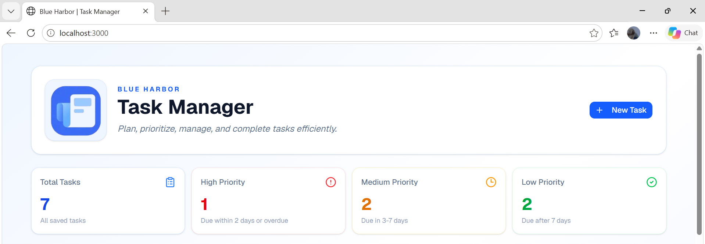

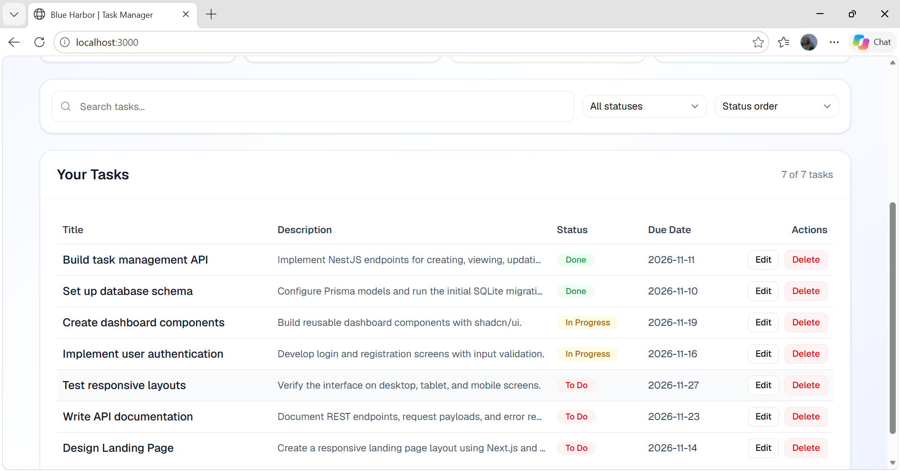

### 2. Create Task

The create-task dialog allows users to enter a title, description, status, and optional due date.

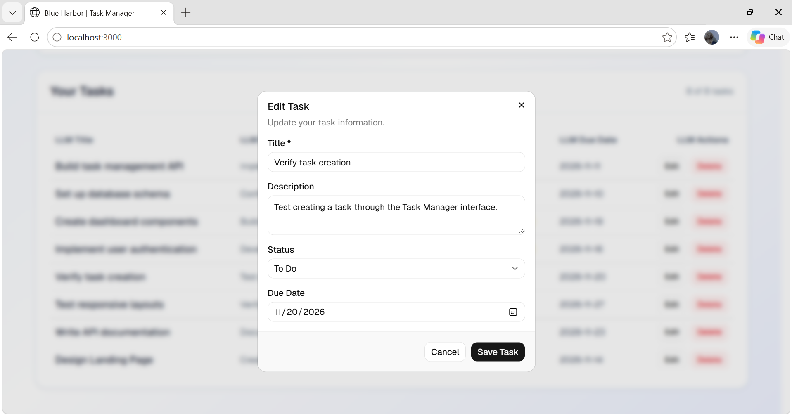

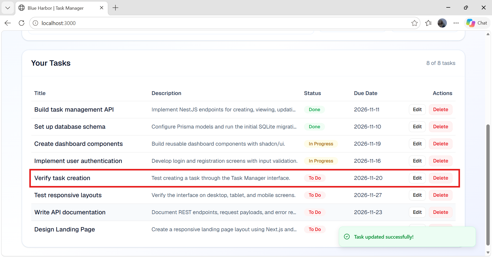

### 3. Edit Task

Existing tasks can be edited to update their information and status.

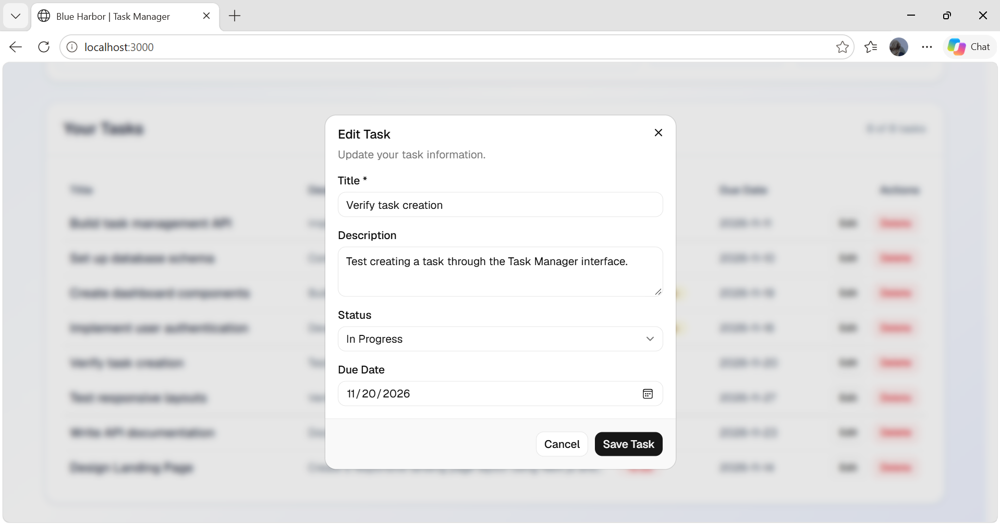

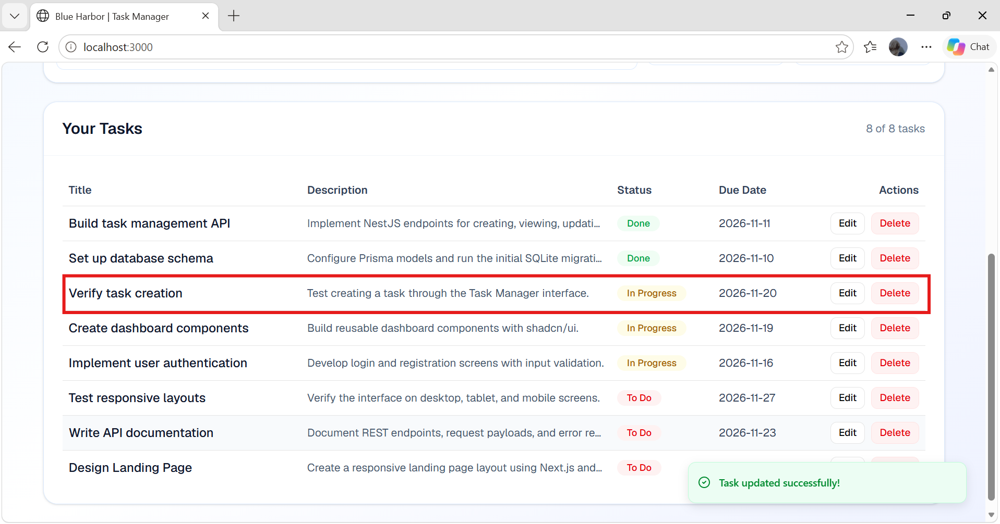

### 4. Delete Task

The application displays a confirmation dialog before deleting a task.

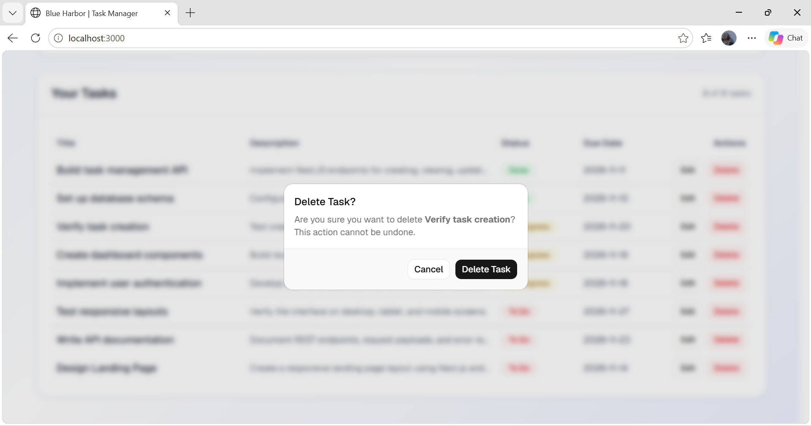

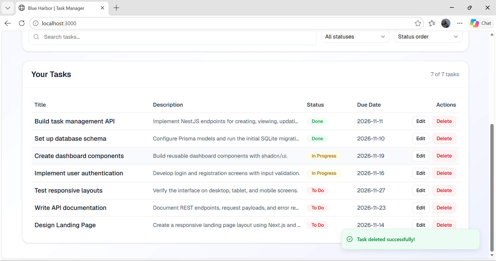

### 5. Filter Tasks by Status

Tasks can be filtered by To Do, In Progress, or Done status.

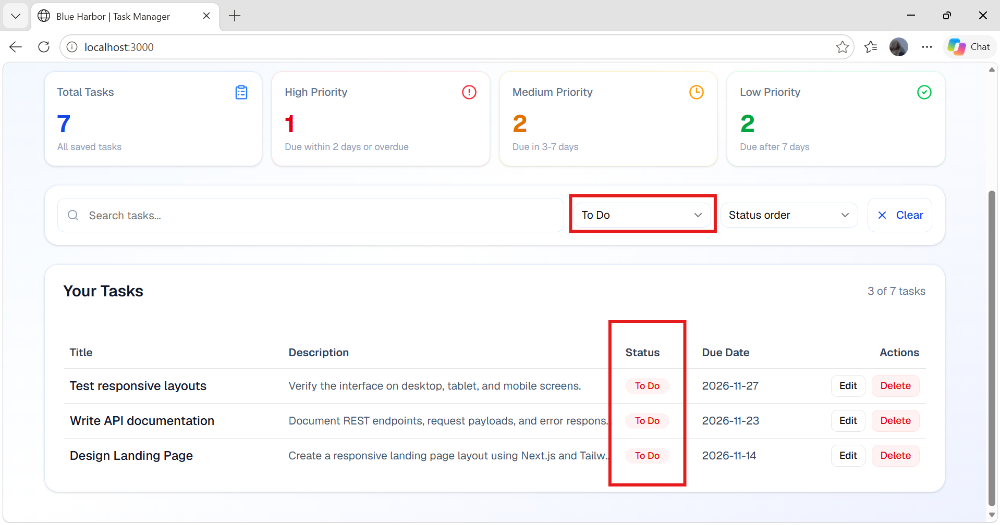

### 6. Sort Tasks by Due Date

Tasks can be sorted by earliest or latest due date. The default view groups tasks by status.

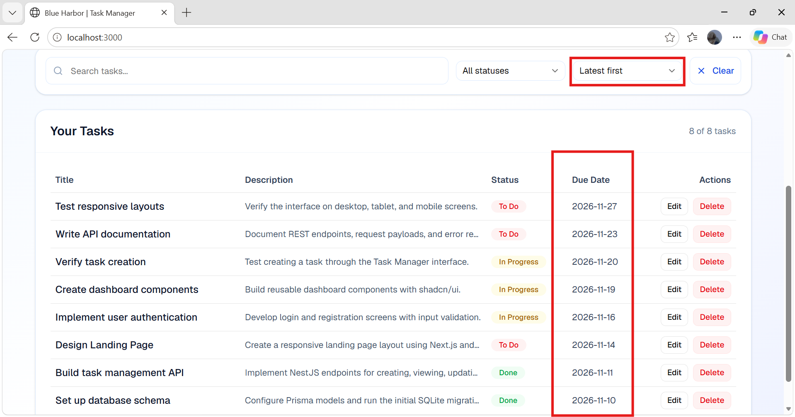

### 7. Search Tasks by Title or Description

The search field filters tasks using matching text from task titles or descriptions.

The screenshot demonstrates searching for `Implement`, returning two matching tasks.

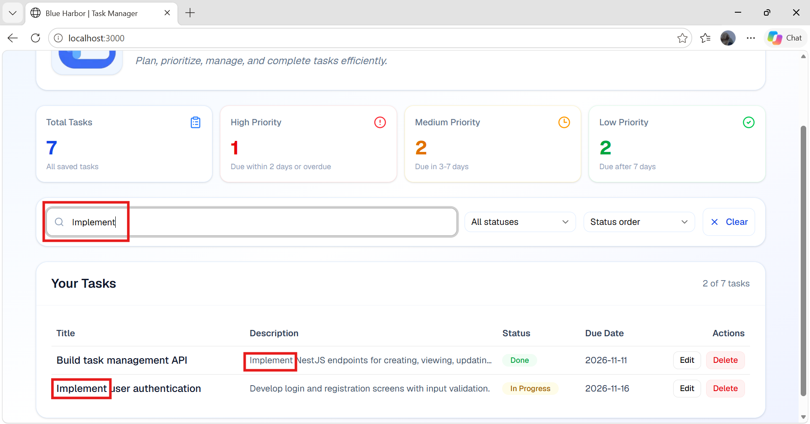

### 8. Docker Compose Validation

Docker Desktop shows the Next.js frontend and NestJS backend running successfully:

- `web-1` - Port 3000
- `api-1` - Port 3001

The backend logs also confirmed that Prisma migrations completed successfully.


### Validation Checklist

| Test | Expected Result |
|---|---|
| Create task | New task is saved and displayed |
| View tasks | Saved tasks appear in the dashboard |
| Edit task | Updated task information is saved |
| Delete task | Confirmation is required before deletion |
| Status filtering | Only tasks matching the selected status are displayed |
| Due-date sorting | Tasks appear in the selected date order |
| Search | Tasks matching the title or description keyword appear |
| Invalid input | API returns HTTP 400 |
| Nonexistent task | API returns HTTP 404 |
| API health check | Returns `{"status":"ok"}` |
| Docker build | Backend and frontend images build successfully |
| Prisma migrations | Database migrations are applied successfully |
| Docker startup | Both containers start successfully |
| SQLite persistence | Tasks remain saved after a normal Docker restart |

**Persistence verification:** Create a task, run `docker compose down`, restart with `docker compose up`, and check that the task remains in the dashboard.

## How I used AI

I used **ChatGPT** as a development assistant for project planning, implementation guidance, debugging, UI improvements, and documentation.

AI helped generate and refine portions of the NestJS API, Next.js components, Prisma integration, and Docker configuration.

I reviewed and modified the suggested code to match the assignment requirements. Changes included improving task table readability, implementing default status-based ordering, refining UI components, and correcting Docker and Prisma configuration issues.

I used application testing, build results, and terminal logs to investigate errors and validate the implementation.

---

**Blue Harbor - Junior Full Stack Developer Technical Assignment**
